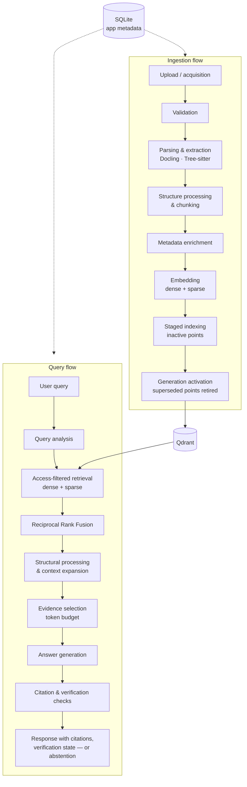

<div align="center">

# OmniRAG

**OmniRAG is an end-to-end RAG engine that fuses dense and sparse retrieval, serves only activated index generations, and synthesizes answers with citations, deterministic verification, and bounded abstention.**


</div>

---

## Table of Contents

- [What is OmniRAG?](#what-is-omnirag)
- [Key Features](#key-features)
- [System Architecture](#system-architecture)
- [Execution Profiles](#execution-profiles)
- [Tech Stack](#tech-stack)
- [Getting Started](#getting-started)
- [Evaluation](#evaluation)
- [Security Architecture](#security-architecture)
- [Roadmap](#roadmap)
- [Documentation](#documentation)

## What is OmniRAG?

OmniRAG is a retrieval-augmented generation system for technical documentation and source-code corpora. Ingestion is structure-aware and feeds a generation-versioned index: a document's chunks become retrievable only when its generation is activated. Queries run dense and sparse retrieval in parallel, merge candidate rankings with [Reciprocal Rank Fusion](https://plg.uwaterloo.ca/~gvcormac/cormacksigir09-rrf.pdf), and pass through token-bounded evidence selection before answer synthesis. Every response is citation-linked and carries verification state from deterministic checks on numeric values, identifiers and citation references; when evidence-sufficiency checks fail, the system returns a bounded abstention instead of an answer. Tenant- and principal-scoped filters are enforced inside every retrieval query, and a LangGraph-based Research workflow extends the same pipeline to bounded, iterative multi-query retrieval with cross-document evidence analysis.

Measurement is part of the architecture: versioned evaluation datasets with validators, per-request experiment manifests, traces, saved artifacts and replayable diagnostics.

v0.1 is a local-development release targeting a single-machine deployment with Qdrant and Ollama.

## Key Features

- **Structure-aware ingestion** — [Docling](https://docling-project.github.io/docling/)-based document parsing and [Tree-sitter](https://tree-sitter.github.io/tree-sitter/) parsing for supported source languages (static parsing only; code is never executed), with section-aware chunking; deterministic context prefixes are stored in chunk metadata, segregated from original source content
- **Hybrid retrieval with rank fusion** — dense embedding search plus sparse lexical search over stable hashed terms with sublinear term-frequency weighting, merged via Reciprocal Rank Fusion, which operates on ranks rather than assuming dense and sparse scores are commensurable
- **Generation-based index lifecycle** — new index points are written in a staged, inactive state; when a document's generation completes it is marked active for retrieval and the superseded generation's point IDs are retired
- **Multi-tenant retrieval filtering** — active-generation, collection, tenant and principal filters applied as Qdrant payload filters in first-pass retrieval and in context expansion
- **Evidence-linked generation** — retrieved text handled as untrusted input; claim-to-evidence association; deterministic numeric, identifier and citation-reference validation; contradiction signals where available; bounded correction and abstention
- **Three execution profiles** — Lite, Core and Research share the retrieval and generation architecture and differ in candidate limits, context budget and verification policy
- **Bounded multi-step research** — a [LangGraph](https://langchain-ai.github.io/langgraph/) workflow implementing query planning, multi-query retrieval and an evidence ledger, capped at 3 rounds, 8 subqueries and a 120-second wall-clock limit
- **Evaluation as a subsystem** — per-request experiment configuration, manifests, traces, saved result artifacts, replay checks, and versioned datasets with schema validators and ground-truth handling safeguards

## System Architecture

A React/TypeScript frontend communicates with a FastAPI backend that coordinates two flows over shared storage: [Qdrant](https://qdrant.tech/documentation/) for dense and sparse vectors with chunk payloads and payload indexes, SQLite for application metadata (conversations, collections, document records, processing status).



Model access goes through OpenAI-compatible HTTP provider adapters, with [Ollama](https://ollama.com) for local serving; embedding and generation providers are configurable per deployment.

## Execution Profiles

| Profile | Candidates | Context budget | Output cap | Policy |
|---|---|---:|---:|---|
| **Lite** | 12 dense + 12 sparse | 700 tokens | 400 tokens | Citation and evidence-sufficiency checks |
| **Core** | 40 dense + 40 sparse | 3,000 tokens | 1,200 tokens | Claim checks, bounded correction, reranking when configured |
| **Research** | up to 50 per channel | 6,000 tokens | 1,800 tokens | LangGraph workflow: planning, iterative retrieval, evidence ledger, cross-document checks |

The profiles encode a trade-off between retrieval breadth, verification depth and execution cost. Research's limits (3 rounds, 8 subqueries, 120 s) are policy bounds that keep iterative retrieval predictable; they are configuration values, not measured latency guarantees.

## Tech Stack

| Layer | Technology | Role |
|---|---|---|
| Backend | Python 3.11+, [FastAPI](https://fastapi.tiangolo.com/), [Pydantic v2](https://docs.pydantic.dev/latest/), Uvicorn | API, pipeline orchestration, typed request/response schemas |
| Frontend | React, TypeScript, [Vite](https://vite.dev/) | Chat and document-management UI |
| Vector store | [Qdrant](https://qdrant.tech/documentation/) | Dense + [sparse vectors](https://qdrant.tech/documentation/concepts/vectors/#sparse-vectors), chunk payloads, payload indexes, tenant/principal filtering |
| App metadata | SQLite | Conversations, collections, preferences, document processing state |
| Models | OpenAI-compatible adapters, [Ollama](https://ollama.com) | Configurable embedding and generation providers |
| Orchestration | [LangGraph](https://langchain-ai.github.io/langgraph/) | Bounded Research workflow |
| Ingestion | [Docling](https://docling-project.github.io/docling/), [Tree-sitter](https://tree-sitter.github.io/tree-sitter/) | Document parsing; source-code parsing |
| Testing & eval | [pytest](https://docs.pytest.org/), [Vitest](https://vitest.dev/), versioned datasets, diagnostic runners | Backend/frontend test suites; retrieval, citation and latency diagnostics |

## Repository Structure

The repository is organized as a full-stack monorepo. The backend is a single installable Python package; operational tooling and evaluation assets remain separate from runtime code.

```text
backend/
  src/omnirag/       Python application packages
frontend/            React + TypeScript application
evaluation/          Evaluation datasets, scorers and benchmark runners
experiments/          Versioned experiment configurations and runtime artifacts
scripts/              Maintenance, diagnostics and operational commands
tests/                Unit, integration and evaluation tests
deploy/               Deployment examples and environment templates
docs/                 Architecture, development and operations documentation
```

## Getting Started

### Prerequisites

- Python 3.11+ and Node.js
- Docker and Docker Compose
- [Ollama](https://ollama.com) for local model serving, or any OpenAI-compatible endpoint

### Quickstart

```bash
git clone <repo-url> && cd OmniRag
cp .env.example .env     # configure providers, Qdrant URL and model names
docker compose up -d     # start the service stack
```

For the reference local model setup:

```bash
ollama pull nomic-embed-text   # embeddings, 768-dim
ollama pull llama3.2:3b        # generation
```

Both models are configurable through the provider adapters. Manual (non-Compose) backend and frontend development setup, the configuration reference and provider options are documented in `docs/`.

## Evaluation

OmniRAG treats evaluation as part of the system: controlled per-request experiment configuration, experiment manifests, traces, saved result artifacts, replay checks, and versioned datasets with validators and ground-truth safeguards. A read-only audit pipeline recomputes stored metrics from saved response and candidate records.

Recorded diagnostic results (single run per profile; 40 attempts each; 33 retrieval-eligible cases with mapped relevant chunks; local Ollama models):

| Metric | Lite | Core | Research |
|---|---:|---:|---:|
| Recall@5 | 95.45% | 95.45% | 92.42% |
| MRR@10 | 96.97% | 96.97% | 96.97% |
| Hit@5 | 32/33 | 32/33 | 32/33 |
| Citation–evidence overlap precision | 88.69% | 82.00% | 92.19% |
| p95 latency | 41.1 s | 51.5 s | 97.8 s |

The independent audit recalculation reported zero discrepancies against the stored retrieval metrics.

Scope of these measurements, stated explicitly:

- The runs used an evaluation snapshot of **18 points across 16 documents** — a diagnostic corpus, not a large-scale benchmark.
- The run dataset's SHA-256 **does not match the officially pinned Phase 8 dataset hash**; results are therefore reported as diagnostic measurements rather than pinned-benchmark results.
- Citation–evidence overlap is an identifier-overlap proxy; it does not measure semantic entailment of claims by evidence.

Full result sets, methodology, outcome reconciliation and the complete list of measurement limitations are in the evaluation documentation under `docs/`.

## Security Architecture

Designed for deployment behind a trusted authenticating reverse proxy:

- Production-mode requests validate a proxy-generated **HMAC-SHA256 signature** computed over user ID, tenant ID and timestamp, with a **60-second validity window**
- Protected routes use **tenant-scoped store access**; retrieval and context expansion enforce **principal and tenant payload filters in Qdrant**
- The deployment contract requires the proxy to strip client-supplied identity headers before signing; local development identity is distinct from production authentication
- Rate limiting is per principal and per process (not a distributed quota)

## Roadmap

- Configure and evaluate semantic claim verification end-to-end (deterministic numeric/identifier/citation checks are in place today)
- Calibrate abstention policy across profiles against verification depth
- Dense-only vs. sparse-only vs. hybrid ablation on the versioned datasets
- Enable and benchmark the reranking stage
- Expanded evaluation corpus against the pinned dataset, and a completed large-scale baseline
- Production hardening: distributed rate limiting, live proxy validation

## Documentation

Architecture notes, configuration reference, experiment manifests and curated evaluation results live under `docs/` and the versioned evaluation directories.

External references: [Qdrant documentation](https://qdrant.tech/documentation/) · [Reciprocal Rank Fusion (Cormack et al., SIGIR 2009)](https://plg.uwaterloo.ca/~gvcormac/cormacksigir09-rrf.pdf) · [LangGraph](https://langchain-ai.github.io/langgraph/) · [Docling](https://docling-project.github.io/docling/) · [Tree-sitter](https://tree-sitter.github.io/tree-sitter/) · [Ollama](https://ollama.com)